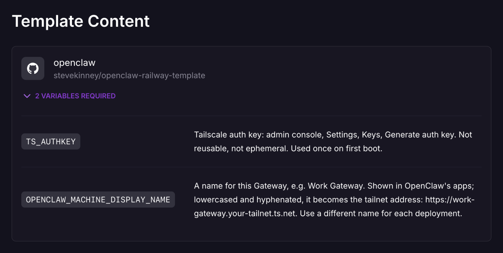

# Quickstart

From nothing to a working dashboard on a private OpenClaw Gateway on Railway,
then the macOS app. About 15 minutes in total; the first build and boot, about
4 minutes of it, is mostly waiting.

You need:

- A Railway account on a paid plan.
- A Tailscale tailnet with **MagicDNS** and
  [**HTTPS certificates**](https://tailscale.com/kb/1153/enabling-https) turned on.
- The device you browse from, with the Tailscale client installed, signed in to
  that tailnet, and connected. The Gateway has no public address, so a device
  that isn't on the tailnet can't open it.
- A model provider API key (Anthropic is shown below).

You don't need the Railway CLI to reach a working dashboard. Step 4 shows when
it becomes useful and how to set it up.

## 1. Get a Tailscale auth key

Admin console → **Settings → Keys → Generate auth key**, with 1-day expiry.

> Tailscale auth key settings: not reusable, not ephemeral, pre-approved if your tailnet requires device approval, and tagged `tag:openclaw` if your policy defines it. Expiry, the machine's key expiry, and why: [TAILSCALE.md](TAILSCALE.md#auth-key-settings)

## 2. Deploy the template

Open the [OpenClaw Private Gateway template](https://railway.com/deploy/openclaw-private-gateway)
(or click **Deploy on Railway** in the [README](../README.md)) and fill in the
two variables it asks for:

| Variable | Value |
| --- | --- |
| `OPENCLAW_MACHINE_DISPLAY_NAME` | a display name for this Gateway, for example `Gowanus` or `Work Gateway` |
| `TS_AUTHKEY` | the key from step 1 |

OpenClaw's apps show the display name as typed. Its lowercase, hyphenated form
becomes the machine name on your tailnet: `Work Gateway` becomes the machine
`work-gateway` and the address
`https://work-gateway.<your-tailnet>.ts.net/`. The rest of this guide writes the
machine name as `<machine-name>`; use yours. Give each deployment its own
display name.



The template generates the Gateway token (`OPENCLAW_GATEWAY_TOKEN`). Wait for
the `openclaw` service to turn green (about 4 minutes; the first build pulls a
large image). On first boot the container logs in to your tailnet with the key,
and a machine named after the Gateway (`work-gateway`) appears. After that, the
node key on the volume logs it in; the auth key is never used again.

The deploy log names the address:

```
openclaw-railway: Tailscale machine name work-gateway, from "Work Gateway"
openclaw-railway: logged in to Tailscale as work-gateway
openclaw-railway: the Gateway will be at https://work-gateway.<your-tailnet>.ts.net/
```

The first request takes about 15 seconds while Tailscale issues the
certificate. If the tailnet already had a machine with that name, Tailscale
adds a suffix (`work-gateway-1`, and the log says `asked for work-gateway`); the
address follows and nothing needs editing. To get the plain name back, remove
the stale machine and rename this one in the admin console.

## 3. Open the dashboard

On a tailnet device, open `https://<machine-name>.<your-tailnet>.ts.net/`. It
signs you in with your Tailscale identity: no token, no device approval, no CLI.
Anyone your Tailscale access policy lets reach the machine can do the same, so
check the policy ([TAILSCALE.md](TAILSCALE.md)).

No model is configured yet, so it starts on **Settings → Model Setup**:


## 4. Add your model provider

There are two ways. They differ in where the key ends up.

### Option A (recommended): a Railway variable, referenced by OpenClaw

The key lives only in a Railway variable. Onboarding stores a reference to it,
not the value, so the key never lands on the volume or in its backups, and you
rotate it by changing the variable ([SECURITY.md](SECURITY.md#rotating-credentials)).
It needs the Railway CLI, which you set up once:

```bash
brew install railway && railway login
ssh-keygen -t ed25519                             # only if ~/.ssh/id_ed25519.pub doesn't exist
railway ssh keys add --key ~/.ssh/id_ed25519.pub  # once per machine
railway link                                      # pick the new project
```

The first `railway ssh` asks you to trust `ssh.railway.com`'s host key. Railway
doesn't publish fingerprints, so accept it on first use.

Copy your Anthropic key, then:

```bash
pbpaste | tr -d '\n' | railway variable set ANTHROPIC_API_KEY --stdin --service openclaw
```

When that deploy is green:

```bash
railway ssh --service openclaw -- openclaw onboard --non-interactive --accept-risk --skip-health \
  --mode local --auth-choice apiKey --secret-input-mode ref \
  --gateway-auth token --gateway-token-ref-env OPENCLAW_GATEWAY_TOKEN \
  --gateway-bind loopback --skip-channels --no-install-daemon
```

The Gateway restarts itself once to apply the result. Check that the agent
answers:

```bash
railway ssh --service openclaw -- openclaw agent --agent main --message "Reply with exactly: OK"
```

For another provider, set its key variable instead (for example
`OPENAI_API_KEY`) and change `--auth-choice`; see `openclaw onboard --help`.

### Option B (quicker): connect it in the dashboard

On **Settings → Model Setup** (or **Models**), choose **Connect provider**,
pick the provider, and paste the key. No CLI and no redeploy.

This stores the key itself, not a reference: OpenClaw writes it to the agent's
auth profile in SQLite on the `/data` volume, in plaintext, where Railway
backups and OpenClaw backup archives contain it. To rotate it, replace it in
the dashboard; changing a Railway variable does nothing. If you later want the
reference-based setup, use Option A.

## 5. Connect the macOS app

Skip this step if you only use the dashboard and Telegram. The app needs the
Gateway token. These commands read it with the Railway CLI (set up under Option
A, whichever option you chose). Keep the token in your Keychain, then point the
app at the Gateway:

```bash
railway variable list --service openclaw --json | jq -j .OPENCLAW_GATEWAY_TOKEN | \
  security add-generic-password -U -a openclaw-railway -s openclaw-railway-gateway-token -w "$(cat)"
security find-generic-password -s openclaw-railway-gateway-token -w | tr -d '\n' | \
  /Applications/OpenClaw.app/Contents/MacOS/openclaw-mac primary set \
    --direct-url wss://<machine-name>.<your-tailnet>.ts.net --token-stdin
```

If `jq` prints nothing, the variable is sealed (Railway never returns sealed
values to `railway variable list`). Open the service's **Variables** tab in the
dashboard instead and reveal the value if it isn't sealed. A sealed token can't
be read back at all: set a new one, which also means updating the Keychain item
([Rotate the token](DEPLOYMENT.md#rotate-the-token)).

`primary set` replaces the app's current primary connection. To add the Gateway
alongside it instead, use `openclaw-mac gateway add Railway --url https://<machine-name>.<your-tailnet>.ts.net --token-stdin`.
It returns right away with the connection `disconnected` until you approve the Mac in step 6; then run `openclaw-mac gateway reconnect Railway`.
In the app you can also do it by hand: **Connection… → Remote (another host)**.

## 6. Approve the Mac

```bash
railway ssh --service openclaw -- openclaw devices list
railway ssh --service openclaw -- openclaw devices approve <requestId>   # each pending request from your Mac
```

Or approve it in the dashboard: **Settings → Devices**, then **Approve** next to your Mac under **Pending approval**.


The app connects within a few seconds. It may then ask you to approve its own
node capabilities, which let the agent run commands on your Mac, including
shell commands. Review them before approving; see
[SECURITY.md](SECURITY.md#local-node-permissions-the-mac).

For a phone, run `railway ssh --service openclaw -- openclaw qr` and scan the
code in the OpenClaw app; it carries `wss://<machine-name>.<your-tailnet>.ts.net`
with full access.

## 7. Finish

- **Tailscale:** if you didn't tag the machine, disable its key expiry in the
  admin console, or it leaves your tailnet after 180 days
  ([why](TAILSCALE.md#auth-key-settings)).
- **Telegram (optional):** see [DEPLOYMENT.md](DEPLOYMENT.md#10-connect-telegram).
- **Backups:** the volume holds your state and the Tailscale node key. Railway's
  scheduled volume backups (`openclaw` → **Backups** → Daily) were not available
  on the Hobby plan, and Railway's backup docs don't say which plans include
  them, so check the tab on yours. An OpenClaw archive (`openclaw backup
  create`) works on any plan and is the alternative; see
  [UPGRADING.md](UPGRADING.md#4-back-up).
- **Audit:** `railway ssh --service openclaw -- openclaw security audit` should
  report 0 critical and one expected warning, `gateway.trusted_proxies_missing`
  ([why](SECURITY.md#security-audit)).
- **Cost and removal:** [DEPLOYMENT.md](DEPLOYMENT.md#cost-and-teardown).

Something wrong? [TROUBLESHOOTING.md](TROUBLESHOOTING.md).
